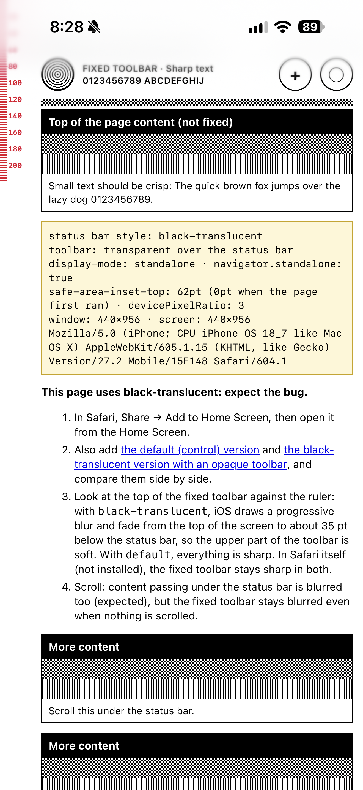
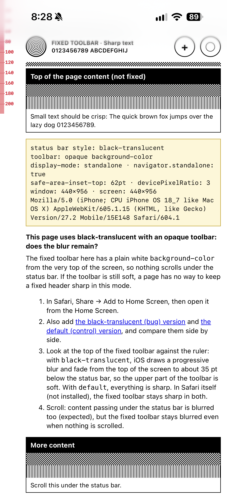
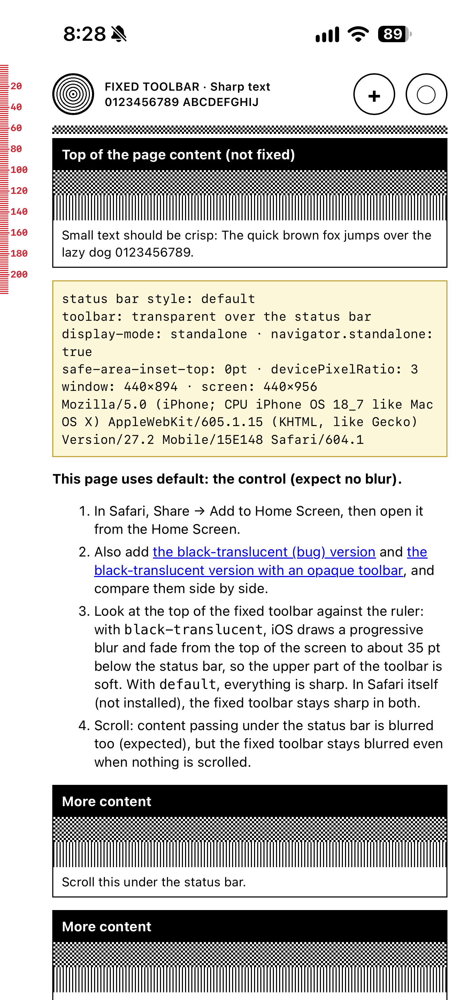
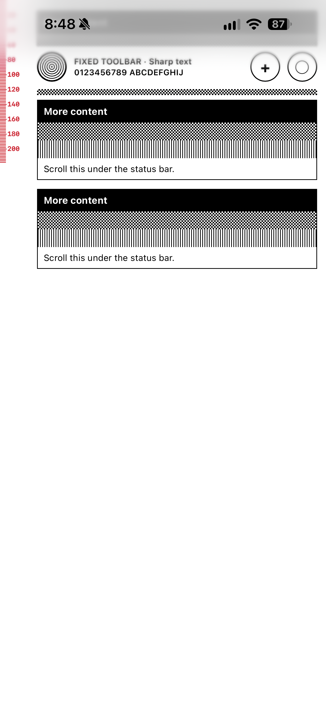
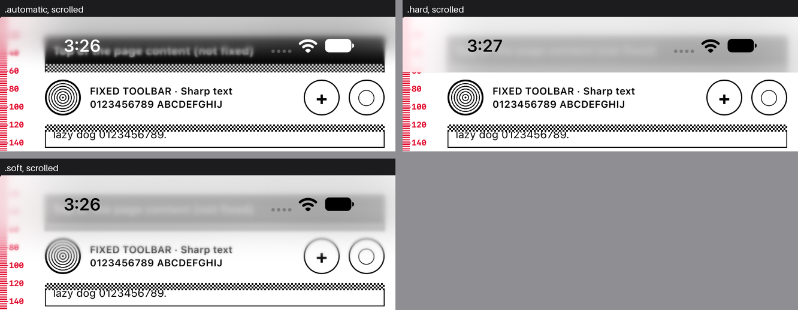

# ios-webview-edge-effect-test

Testing an issue in the iOS WebView edge effect, with reproductions of said issue.

## The issue

On iOS 27, a web app opened from the Home Screen with `apple-mobile-web-app-status-bar-style` set to
`black-translucent` and `viewport-fit=cover` gets the system's top scroll edge effect (a progressive blur and fade)
from the top of the screen to about 35 pt below the status bar. That band covers `position: fixed` toolbars placed
just under the status bar, and the page has no way to prevent it. It is tracked as
[WebKit bug 324438](https://bugs.webkit.org/show_bug.cgi?id=324438).

The full write-up, with measurements, analysis and suggested fixes, is in **[docs/report.md](docs/report.md)**.

## What is here

| Path | Contents |
|---|---|
| [`docs/report.md`](docs/report.md) | The report for Apple (Feedback Assistant) and WebKit |
| [`repro/`](repro) | The three reproduction pages (static HTML, one stylesheet, one script), published with GitHub Pages |
| [`docs/device/`](docs/device) | Screenshots from a real iPhone 18 Pro Max on iOS 27.2 |
| [`App/`](App) | A test app that applies each edge effect style to a web view |
| [`scripts/`](scripts) | Build and run the test app; measure and compare screenshots |
| [`results` branch](../../tree/results) | Simulator screenshots and reports from each test run |

## Reproduction pages

The pages are published at https://benark.github.io/ios-webview-edge-effect-test/, so they can be added to the Home
Screen from Safari (Share → Add to Home Screen):

- Bug: https://benark.github.io/ios-webview-edge-effect-test/translucent/ (`black-translucent`; the toolbar is
  transparent over the status bar)
- Opaque toolbar: https://benark.github.io/ios-webview-edge-effect-test/translucent-solid/ (`black-translucent`; the
  toolbar has a plain white `background-color` from the top of the screen)
- Control: https://benark.github.io/ios-webview-edge-effect-test/default/ (`default`)

The **Publish reproduction pages** workflow deploys `repro/` whenever it changes on `main`. It needs Settings → Pages →
Source set to "GitHub Actions".

Each has a fixed toolbar of fine test patterns (rings, a 2 px checkerboard, small text), a red ruler on the left edge
marked in points from the top of the screen, and a yellow box that reports the environment. Find where the ruler's
tick marks become sharp: that is where the effect ends.

On a real iPhone the effect ends at about 97 pt on both `black-translucent` pages, 35 pt below the 62 pt safe area
inset, and the control is sharp everywhere:

| Bug | Opaque toolbar | Control | Bug, scrolled |
|---|---|---|---|
|  |  |  |  |

## The edge effect test

A web page cannot change the edge effect; only the native app that hosts the web view can. `App/` is a small app that
stands in for the Home Screen web app shell: a full-screen `WKWebView` that loads a reproduction page and applies one
setting to `webView.scrollView.topEdgeEffect`. The workflow runs it in an iOS simulator and takes a screenshot of each
case:

| Case | Page | Edge effect | Scrolled |
|---|---|---|---|
| `automatic-top` | Bug | default | no |
| `automatic-scrolled` | Bug | default | yes |
| `soft-top` | Bug | `.soft` | no |
| `soft-scrolled` | Bug | `.soft` | yes |
| `hard-top` | Bug | `.hard` | no |
| `hard-scrolled` | Bug | `.hard` | yes |
| `hard-solid-top` | Opaque toolbar | `.hard` | no |
| `hidden-top` | Bug | hidden | no |

## Results

Runs 1 and 2: iPhone 18 Pro Max simulator, iOS 27.2, Xcode 27.2. The web view reports `safe-area-inset-top: 62pt` and
a 440 × 956 window, the same as the Home Screen web app on the real iPhone. Both runs give the same numbers, and their
screenshots are identical pixel for pixel below the status bar clock. Screenshots, reports and `measurements.txt` are
in the [`run-N` folders on the `results` branch](../../tree/results).

| Top edge effect | Ruler shows from | Ruler sharp from | Fixed toolbar (starts at 62 pt) |
|---|---|---|---|
| `.automatic`, the iOS 27 default | 42 pt | 60 pt | sharp |
| `.hard` | 60 pt | 63 pt | sharp |
| `.soft` | 72 pt | 96 pt | upper 35 pt blurred |
| hidden | 0 pt | 0 pt | sharp |
| Home Screen web app on the real iPhone | 72 pt | 96 pt | upper 35 pt blurred |

- **`.automatic` and `.hard` stay inside the status bar area.** From 62 pt down, which is the bottom of the top safe
  area inset, both screenshots are identical pixel for pixel to the one with the effect hidden. Content scrolled under
  the status bar is still blurred, so the system indicators stay protected.
- **`.soft` is what Home Screen web apps get.** Its ruler profile matches the real iPhone's Home Screen web app: the
  ticks show from 72 pt and are sharp from 96 pt in both, and the contrast in between agrees to within 5 percentage
  points. The opaque-toolbar page gives the same result as the transparent one.
- So the band that covers fixed toolbars comes from the soft style. With the style a plain `WKWebView` gets by
  default on iOS 27, or with the hard style, the effect ends where the page's safe area begins.

Apple changed the default in iOS 27. From WWDC26 session 278,
[Modernize your UIKit app](https://developer.apple.com/videos/play/wwdc2026/278/): "the .automatic style no longer
switches between the existing soft and hard styles but provides its own visuals for additional clarity. If you have
overridden the style from .automatic previously, that decision should be re-evaluated, especially when set to .soft,
as that no longer matches the default system appearance."

## Running the test

Actions tab → **Edge effect test** → **Run workflow**. Each run:

- saves the screenshots, a text report per case and `measurements.txt` in a `run-N` folder on the
  [`results`](../../tree/results) branch, and
- attaches the same files to the run as the `screenshots` artifact.

The test serves `repro/` from the checkout on `localhost`, so it tests the pages in the commit it runs on. To test a
published copy, give the workflow a `base_url`, or set `BASE_URL` for `scripts/run.sh`.

To run it on a Mac: `scripts/build.sh && scripts/run.sh` (Xcode 27 with an iOS 27 simulator).

## Checking the numbers

Both scripts need Pillow and NumPy.

- `python3 scripts/measure.py docs/device/*.png` prints where the ruler shows and becomes sharp in each screenshot.
- `python3 scripts/compare.py a.png b.png` prints the largest pixel difference between two screenshots, band by band.
  For example, `docs/device/fade-solid.png` against `docs/device/fade-bug.png` shows that an opaque toolbar changes
  nothing.

## Limits

- The edge effect test runs in a simulator, not on a device, and uses a plain `WKWebView`, not Apple's Home Screen
  shell. The soft case matching the real iPhone is the evidence that the simulator draws the effect faithfully.
- That Home Screen web apps use the soft style is inferred from that match. The shell's code is not public.
