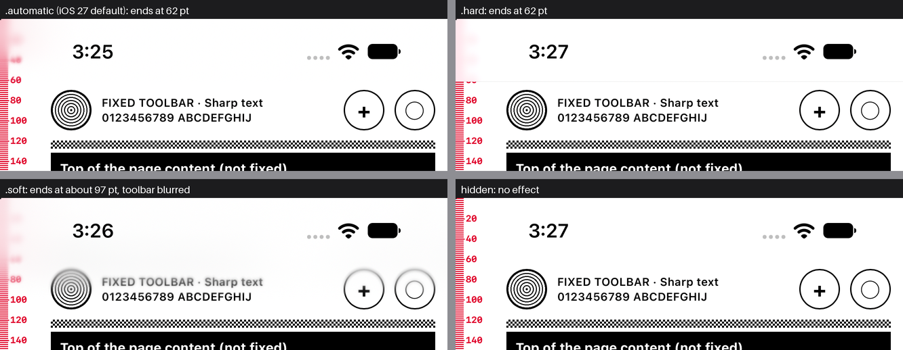

# ios-webview-edge-effect-test

Testing an issue in the iOS WebView edge effect, with reproductions of said issue.

## The issue

On iOS 27, a web app opened from the Home Screen with `apple-mobile-web-app-status-bar-style` set to
`black-translucent` and `viewport-fit=cover` gets the system's top scroll edge effect (a progressive blur and fade)
from the top of the screen to about 35 pt below the status bar. That band covers `position: fixed` toolbars placed
just under the status bar, and the page has no way to prevent it. It is tracked as
[WebKit bug 324438](https://bugs.webkit.org/show_bug.cgi?id=324438).

## What this repository tests

A web page cannot change the edge effect; only the native app that hosts the web view can. `App/` is a small app that
stands in for the Home Screen web app shell: a full-screen `WKWebView` that loads a reproduction page and applies one
setting to `webView.scrollView.topEdgeEffect`. The workflow runs it in an iOS simulator and takes a screenshot of each
case:

| Case | Page | Edge effect | Scrolled |
|---|---|---|---|
| `automatic-top` | toolbar transparent over the status bar | default | no |
| `automatic-scrolled` | same | default | yes |
| `soft-top` | same | `.soft` | no |
| `soft-scrolled` | same | `.soft` | yes |
| `hard-top` | same | `.hard` | no |
| `hard-scrolled` | same | `.hard` | yes |
| `hard-solid-top` | opaque toolbar from the top of the screen | `.hard` | no |
| `hidden-top` | toolbar transparent over the status bar | hidden | no |

## Results

Run 1: iPhone 18 Pro Max simulator, iOS 27.2, Xcode 27.2. The web view reports `safe-area-inset-top: 62pt` and a
440 × 956 window, the same as the Home Screen web app on a real iPhone 18 Pro Max. Screenshots and reports are in
[`run-1` on the `results` branch](../../tree/results/run-1).

| Top edge effect | Ruler shows from | Ruler sharp from | Fixed toolbar (starts at 62 pt) |
|---|---|---|---|
| `.automatic`, the iOS 27 default | 42 pt | 60 pt | sharp |
| `.hard` | 60 pt | 63 pt | sharp |
| `.soft` | 72 pt | 96 pt | upper 35 pt blurred |
| hidden | 0 pt | 0 pt | sharp |
| Home Screen web app on a real iPhone 18 Pro Max, iOS 27.2 | 72 pt | 96 pt | upper 35 pt blurred |

- **`.automatic` and `.hard` stay inside the status bar area.** From 62 pt down, which is the bottom of the top safe
  area inset, both screenshots are identical pixel for pixel to the one with the effect hidden. Content scrolled under
  the status bar is still blurred, so the system indicators stay protected.
- **`.soft` is what Home Screen web apps get.** Its ruler profile matches the real iPhone's Home Screen web app: the
  ticks show from 72 pt and are sharp from 96 pt in both, and the contrast in between agrees to within 5 percentage
  points. The opaque-toolbar page gives the same result as the transparent one.
- So the band that covers fixed toolbars comes from the soft style. With the style a plain `WKWebView` gets by
  default on iOS 27, or with the hard style, the effect ends where the page's safe area begins.

Apple changed the default in iOS 27. From WWDC26 session 278,
[Modernize your UIKit app](https://developer.apple.com/videos/play/wwdc2026/278/): "the .automatic style no longer
switches between the existing soft and hard styles but provides its own visuals for additional clarity. If you have
overridden the style from .automatic previously, that decision should be re-evaluated, especially when set to .soft,
as that no longer matches the default system appearance."

`scripts/measure.py` prints the ruler numbers for any screenshot.

## Running it

Actions tab → **Edge effect test** → **Run workflow**. Each run:

- saves the screenshots and a text report per case in a `run-N` folder on the
  [`results`](../../tree/results) branch, and
- attaches the same files to the run as the `screenshots` artifact.

To run it on a Mac: `scripts/build.sh && scripts/run.sh` (Xcode 27 with an iOS 27 simulator).

## Reading a screenshot

The pages have a red ruler on the left edge marked in points from the top of the screen, and a toolbar of fine test
patterns (rings, a 2 px checkerboard, small text). Find where the ruler's tick marks become sharp: that is where the
effect ends. Each report lists the page's own readout (`safe-area-inset-top`, window size) and the web view's insets.

## Limits

- This is a simulator, not a device, and a plain `WKWebView`, not Apple's Home Screen shell. The soft case matching
  the real iPhone is the evidence that the simulator draws the effect faithfully.
- That Home Screen web apps use the soft style is inferred from that match. The shell's code is not public.
- The pages load from the live site, so a run needs network access.
